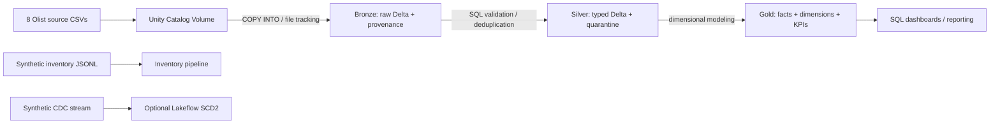

# ShopPulse | Retail Data Engineering Lakehouse

**End-to-end retail data platform built with Databricks SQL, Delta Lake, PySpark, Unity Catalog, and Lakeflow.** The project integrates historical e-commerce data, applies quality controls, and produces analytics-ready models for commercial and operations reporting.

> **Implementation status:** The batch ingestion, transformation, modeling, automated quality-check, and deployment definitions are committed. An initial Olist orders ingestion of 99,441 rows was verified in a Databricks workspace. End-to-end execution of the expanded eight-source pipeline and optional streaming workflows still requires runtime validation. See [validation status](docs/validation_status.md).

## Business challenge

E-commerce teams often receive orders, products, customer records, payments, and delivery updates from different source systems. They need consistent answers to questions such as:

- How much merchandise value was delivered by day and product category?
- Which customers return and purchase again?
- Which orders were delivered later than promised?
- Why do payment totals and merchandise charges differ?
- How can data ingestion be rerun safely without double-counting transactions?

ShopPulse builds a governed lakehouse to preserve source data, apply consistent business rules, identify exceptions, and expose reliable analytical tables. A **separate synthetic warehouse feed** exercises inventory movements, updates, and late-arriving data. The historical e-commerce data comes from the [Brazilian E-Commerce Public Dataset by Olist](https://www.kaggle.com/datasets/olistbr/brazilian-ecommerce), covering 2016–2018. Synthetic operational data is explicitly labeled.

## Solution architecture



**Bronze** retains source records and file metadata. **Silver** standardizes types, identifies duplicate business keys, and isolates invalid rows. **Gold** publishes dimensional models and business aggregates. Databricks Jobs connect the main batch stages; separate Lakeflow examples cover incremental ingestion and CDC.

## Technology and engineering decisions

| Area | Implementation | Why |
|---|---|---|
| File ingestion | Unity Catalog Volumes + `COPY INTO` | Track ingested files and support repeatable loads |
| Storage | Delta Lake | Transactional tables, history, schema management |
| Data transformation | Databricks SQL, Spark SQL | Declarative typing, deduplication, filtering, aggregations |
| Quality | Quarantine tables and Python quality gates | Preserve invalid records and block inconsistent outputs |
| Modeling | Order-item fact, order-level payment fact, customer/product/seller dimensions | Avoid many-to-many join fan-out |
| Workflow automation | Declarative Automation Bundle + four-task Job | Repeatable development deployment |
| Advanced event handling | Synthetic inventory, `MERGE`, Auto Loader, `AUTO CDC` | Demonstrate revisions and incremental patterns |
| Observability | SQL monitoring queries and operational runbooks | Diagnose failures and reconcile key metrics |

## Data products

| Gold table | Grain | Business purpose |
|---|---|---|
| `fact_order_item` | One order line | Product sales, freight, seller analysis |
| `fact_order_payment` | One order | Aggregated payment components |
| `daily_delivered_sales` | Purchase date | Delivered-order volume and merchandise sales |
| `customer_lifetime_value` | Distinct shopper | Repeat purchasing and historical customer value |
| `delivery_performance` | Purchase date | Late deliveries and elapsed delivery time |
| `order_payment_reconciliation` | One order | Payment-versus-item variance investigation |
| `inventory_net_movement` | Warehouse + SKU | Synthetic net movement, not current inventory on hand |

**Metric disclaimer:** Amounts are in **BRL**. `item_sales_brl` measures delivered-order item merchandise value; it is **not** net accounting revenue or profit. Payments are aggregated before joining to order-level measures to prevent double-counting.

## Repository structure

```text
sql/
  01–03                    Initial SQL and Delta transaction reference cases
  10–12                    Bronze DDL, file ingestion, source profiling
  20–23                    Silver cleaning, validation and quarantine
  30–31                    Gold dimensions, facts and business aggregates
  40–41                    Monitoring and analytics queries
  60–61                    Synthetic inventory and Delta MERGE scenarios
  70–72                    Optimization, governance and semi-structured data
src/shoppulse/runner.py     Spark SQL execution and quality gates
resources/job.yml          Four-stage Databricks job definition
pipelines/                 Optional Auto Loader and AUTO CDC implementations
tools/                     Synthetic event generators
tests/                     Python unit tests
.github/workflows/ci.yml  Static and unit-test workflow
docs/                      Architecture, contracts, runbook, operations and validation
databricks.yml             Deployment bundle configuration
```

## Run the pipeline

1. Download the original Olist CSV dataset and select the eight source files listed in the [data dictionary](docs/data_dictionary.md). Source data is **not** checked into GitHub.
2. Choose a writable Unity Catalog catalog. Defaults use `workspace`.
3. Execute `sql/10_bronze_setup.sql` after replacing `{{catalog}}` with the selected catalog.
4. Upload CSVs to `/Volumes/workspace/shoppulse_bronze/source_files/`, then run `sql/11_bronze_copy_into.sql` and `sql/12_bronze_audit.sql`.
5. Execute the Silver scripts in order (`20`–`23`), followed by the Gold scripts (`30`–`31`).
6. Run data-quality and reconciliation checks (`40`–`41`), or use the staged batch job in `resources/job.yml` after Databricks CLI validation.

See the [operator runbook](docs/runbook.md) for detailed manual and automated steps, prerequisites, and failure recovery. SQL templates use `{{catalog}}`, substituted by the Python runner or replaced in SQL Editor.

## Validation and reproducibility

- **Observed in a Databricks workspace:** 99,441 orders ingested, 99,441 distinct order IDs, and a repeated `COPY INTO` invocation leaving the row count unchanged.
- **Implemented, not yet live-verified:** expanded multi-file loads, Silver/Gold outputs, job bundle deployment, streaming CDC pipeline and performance measurements.
- **CI:** GitHub Actions jobs have been blocked before test execution by an account-level restriction; no test results are available. See the [CI status](docs/ci_triage.md). This is **not** presented as a passing test suite.

All synthetic feed generators use deterministic seeds. Automated checks cover key uniqueness, item referential integrity, and invalid amounts. For operational limitations and future hardening, see [engineering capabilities](docs/engineering_capabilities.md) and [implementation plan](docs/roadmap.md).

## Documentation

[Architecture](docs/architecture.md) · [Data dictionary](docs/data_dictionary.md) · [Runbook](docs/runbook.md) · [Engineering capabilities](docs/engineering_capabilities.md) · [Operations](docs/operations.md) · [Security](docs/security.md) · [Validation status](docs/validation_status.md) · [Implementation history](docs/implementation_history.md)

## Responsible data handling

The Olist source files should be obtained from their original publisher. Do not commit raw customer data, credentials, workspace IDs, or personal logs. The project is a **portfolio reference implementation**, not an operated production service. Production deployment would require validated execution, stronger alerting, controlled environments, incident procedures and approved privacy controls.

