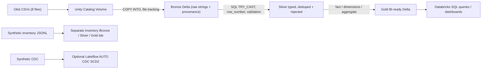

# ShopPulse | Databricks Lakehouse Data Engineering

**An end-to-end retail lakehouse reference project** using Databricks SQL, Delta Lake, Unity Catalog, PySpark, Lakeflow patterns, tests, and deployment-as-code. Designed for a data engineering GitHub portfolio and the **Databricks Certified Data Engineer Professional** exam (October 9, 2026 outline).

> **Honest status:** Core batch ingestion, Medallion transformations, dimensional Gold models, orchestration definition, quality gates, and certification labs are implemented in this repository. The first 99,441 Olist orders were previously ingested and verified in the learner's Databricks Free Edition workspace. The expanded end-to-end run, deployment, performance results, and optional streaming/CDC labs **have not yet been executed or validated in that workspace**. Local static/stdlib tests are separate from Spark integration testing. This is not a claimed production deployment.

## Business scenario
ShopPulse (fictional retailer) must reconcile marketplace orders, order items, payment records, deliveries, product catalog, seller and customer reference data. An additional **synthetic** warehouse feed supports inventory changes, duplicates, out-of-order updates, and incident simulations. The historical Olist data covers 2016–2018; these are not present-day transactions.

## Architecture



**Important distinctions:** File-level idempotency is not record-level deduplication. Payment rows and order-item rows are both 1:N for each order; joining them directly before aggregation inflates sums. Olist uses **BRL** and our `item_sales_brl` represents delivered-order item merchandise value, **not legally recognized revenue** or net profit.

## Quick start: reproducible batch pipeline

1. Get **all eight original CSV files** from [Olist on Kaggle](https://www.kaggle.com/datasets/olistbr/brazilian-ecommerce). **Do not commit the dataset**. The initial learner exercise already has orders and order items; upload the other six as well.
2. In Databricks Free Edition, select a writable Unity Catalog catalog (the examples use `workspace`).
3. Run `sql/10_bronze_setup.sql` with `{{catalog}}` replaced by `workspace`. This creates the three Medallion schemas, a managed volume, and eight Bronze Delta tables. Existing lesson tables remain untouched.
4. Upload the CSV files with **Catalog Explorer → workspace → shoppulse_bronze → source_files → Upload to volume**, keeping the original file names.
5. Run `sql/11_bronze_copy_into.sql`. Re-running the same files normally skips them. Then run `sql/12_bronze_audit.sql`.
6. Run Silver scripts `20` → `21` → `22` → `23` in order, **in the same SQL Editor session** (temporary views are used by the `20` and `21` scripts). SQL Editor may execute statements individually, so keep each script's statements in the same session.
7. Run Gold scripts `sql/30_gold_model.sql` then `sql/31_gold_metrics.sql`, followed by monitoring and analytic queries in `sql/40_monitoring_checks.sql` and `sql/41_analytics_queries.sql`.
8. Optional: run the automated Spark Python workflow after configuring the Databricks CLI and checking your workspace supports serverless Jobs: `databricks bundle validate -t dev`, `databricks bundle deploy -t dev`, `databricks bundle run shoppulse_batch -t dev`. Never deploy before uploading all eight CSV files and confirming the target catalog.

For a detailed annotated walkthrough, see [runbook](docs/runbook.md). All `sql/10–41` scripts are templates: `{{catalog}}` is substituted by `src/shoppulse/runner.py` or replaced manually in SQL Editor. Historical `sql/01–03` lessons use a fixed `shoppulse_dev` schema and are preserved.

## Project tree

```text
.github/workflows/ci.yml    Static Python compile + unit tests (no workspace secrets)
databricks.yml              Declarative Automation Bundle
resources/job.yml           Four-stage serverless batch workflow
src/shoppulse/runner.py     CLI-oriented Spark SQL orchestration and quality gates
sql/01–03                  Historical learner exercises
sql/10–12                  Bronze setup, COPY INTO, profile
sql/20–23                  Silver clean/invalid quarantine and reference tables
sql/30–31                  Gold facts, dimensions, metrics
sql/40–41                  Monitoring and analytics
sql/60–61                  Synthetic warehouse and MERGE CDC labs
sql/70–72                  Performance, governance, VARIANT, AI examples
pipelines/                 Optional Lakeflow streaming and SCD2 AUTO CDC examples
tools/                     Reproducible synthetic event generators
tests/                     Pure Python tests (NOT Spark integration tests)
docs/                      Architecture, data contracts, runbook, incident playbook,
                           certification matrix, governance, progress and caveats
```

## Expected verification, not fake benchmarks
- **Previously observed:** Bronze Olist orders = 99,441 rows; distinct non-null order IDs = 99,441; re-running original `COPY INTO` left the row count unchanged.
- **Upstream reference:** Olist order items commonly contain 112,650 rows, but verify **your own uploaded data**, not a copied result.
- **Not yet confirmed:** all eight sources loaded; Silver/Gold validation and runtime performance; Lakeflow execution; CI workflow result on this commit.
- **Known deliberate issues:** quarantines are derived by SQL; synthetic warehouse contains a duplicate, invalid amount, and updated event version. A full live job run is needed to verify exact rejected counts.

## Professional certification coverage
Updated for the official [Oct 9, 2026 Professional exam guide](https://www.databricks.com/sites/default/files/2026-10/Databricks-Certified-Data-Engineer-Professional-Exam-Guide-9-Oct-2026.pdf) (**9 domains, 60 scored questions, 120 minutes**). The nine domain-to-project mappings and feature gaps are detailed in [docs/exam_matrix.md](docs/exam_matrix.md).

## Safety, compliance and reproducibility
- Olist is third-party data: download from its original source and review its terms; **do not commit raw data**, personal details, or tokens.
- `.gitignore` protects local credentials and generated files; also review `git diff` before publishing.
- This repository is a portfolio implementation with isolated training examples, not a substitute for an operated, production-level SLA environment.
- A proper production system would require CI with a workspace integration environment, secret management, least privilege, freshness checks, deletion policy, monitoring, CDC replay strategy, and verified recovery runbooks.

## Start here
[Runbook](docs/runbook.md) · [Architecture](docs/architecture.md) · [Data dictionary](docs/data_dictionary.md) · [Exam matrix](docs/exam_matrix.md) · [Operations](docs/operations.md) · [Progress](docs/learning_log.md)

