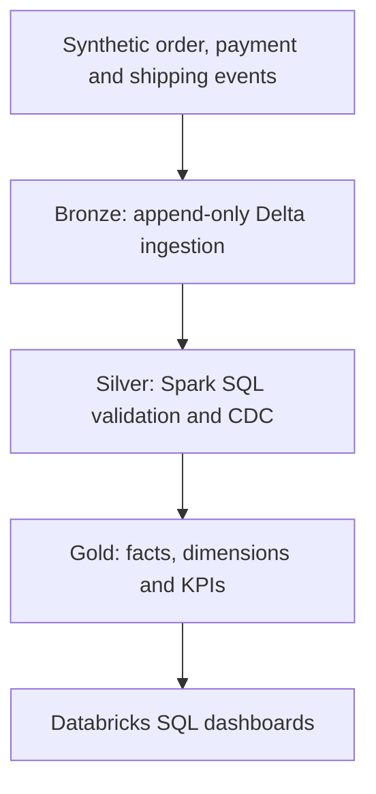

# ShopPulse Lakehouse Architecture

> **Planned design.** Only the introductory Delta tables and SQL exercises exist today.

## Business requirements

1. Daily delivered-order count and revenue.
2. On-time delivery percentage and late-shipment root causes.
3. Refunds, cancellations, and revenue reconciliation.
4. Repeat-customer and product-level performance.
5. Idempotent updates when pipelines rerun or events arrive late.
6. Historical customer attributes with SCD Type 2 when appropriate.

## Guiding engineering rules

- Clearly define each table's grain before joining or aggregating.
- Preserve original source records in Bronze for auditability.
- Quarantine invalid rows and record data quality metrics in Silver.
- Build Gold models for specific business requirements.
- Enforce least-privilege access and protect personally identifiable data.
- Test reruns, corrections, late data, and reconciliation totals.

The current `orders_raw.amount` field is an introductory fixture; a production revenue model must define financial recognition rules and prevent join fan-out or double counting.
